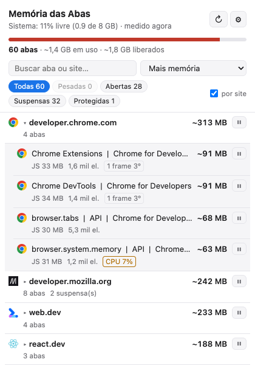

# Memória das Abas

Extensão de navegador que mostra **quais abas estão pesando** e **suspende as mais pesadas** quando a RAM do computador aperta. Funciona no Chrome, Edge, Brave, Opera, Vivaldi, Arc, Dia (Chromium) e, em modo experimental, no Firefox. Windows, macOS e Linux.

  
  
  

- Lista as abas da mais pesada para a mais leve (memória estimada, elementos, frames de terceiros, CPU, tempo parada).
- Feita para muitas abas: resumo (total em uso e liberado), busca, filtros (pesadas, abertas, suspensas, protegidas), ordenação por memória/CPU/tempo parada, agrupamento por site e paginação.
- Suspende uma aba, um site inteiro ou tudo o que está filtrado (com confirmação; abas protegidas ficam de fora).
- O ícone mostra quantas abas estão pesadas. Configurações e histórico ficam na página de opções (⚙).
- Quando a RAM livre cai abaixo do limite, suspende até 2 abas paradas por minuto. Elas continuam na barra e recarregam ao clicar.
- **Nunca suspende automaticamente:** a aba ativa, abas tocando som, abas usando câmera/microfone/compartilhando a tela, abas com texto digitado e não enviado, abas fixadas (opcional) e sites protegidos.

## Instalar

**Chromium (Chrome, Edge, Brave, Opera, Vivaldi, Arc, Dia):** `chrome://extensions` (ou `edge://extensions`) → ligar **Modo do desenvolvedor** → **Carregar sem compactação** → escolher esta pasta.

**Firefox 128+:** rode `python3 ferramentas/empacotar.py` e, em `about:debugging#/runtime/this-firefox` → **Carregar extensão temporária**, escolha `dist/memoria-das-abas-<versão>-firefox.zip`. (O `manifest.json` da raiz é o do Chromium; o script gera o do Firefox.)

## Suporte por navegador

| | Chromium | Firefox |
|---|---|---|
| Lista e peso das abas | ✅ | ✅ (sem memória do JS) |
| RAM do sistema e suspensão pelo limite | ✅ | ❌ sem API; suspende só abas *pesadas* e paradas |
| CPU por aba | ✅ | ❌ sem `longtask` |
| Status | testado | **experimental**, sem teste manual ainda |

Safari ainda não é suportado (precisa de conversão via Xcode). Contribuições são bem-vindas.

## Como funciona

`medidor.js` roda em cada página e só responde quando o background pede. `midia.js` (mundo da página) só informa se há câmera/microfone/tela em uso. A cada minuto o `background.js` mede as abas, atualiza o ícone e decide o que suspender (`tabs.discard`).

Estimativa por aba: `30 MB + heap JS + 1,5 MB por mil elementos + 25 MB por frame de terceiro`. É uma **estimativa**: navegadores não expõem a memória real por aba para extensões. Para o número exato, use o gerenciador de tarefas do navegador (Shift+Esc no Windows/Linux, `about:processes` no Firefox).

## Privacidade

Nada sai da máquina: não há nenhuma requisição de rede. A última medição fica em `storage.session` (some ao fechar o navegador). As configurações e o histórico das últimas 30 suspensões (título e URL) ficam em `storage.local`. Detalhes na [política de privacidade](PRIVACY.md).

## Contribuir

Issues e PRs são bem-vindos. Testes: `node --test`. Pacotes para as lojas: `python3 ferramentas/empacotar.py` (gera `dist/`). Ideias em aberto:

- Estimativa melhor: somar imagens decodificadas, `<canvas>` e vídeos tocando
- Medir com menos frequência quando há RAM sobrando
- Escolher o que suspender por peso × tempo parada
- Medição real via app auxiliar opcional (*native messaging*): memória real do navegador por processo e pressão de memória do sistema no macOS/Windows/Linux
- Botão "proteger este site" em cada linha e atalhos de teclado
- Notificações e gráfico do peso de cada aba ao longo do tempo
- Traduções (`_locales`), testes no Firefox e versão para Safari

## Licença

[MIT](LICENSE)

---

**English:** browser extension (Chromium + experimental Firefox) that shows which tabs use the most memory and discards the heaviest idle ones when system RAM runs low. Nothing leaves your machine. Contributions welcome, including translations.
