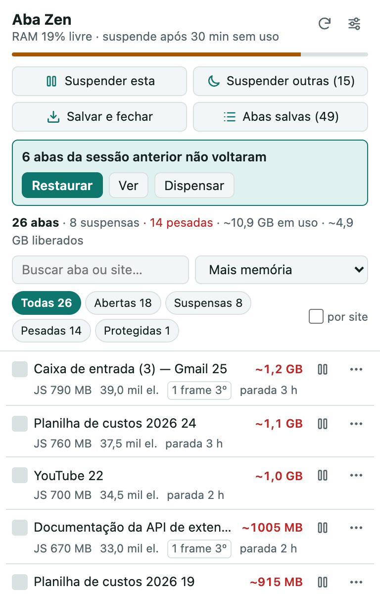
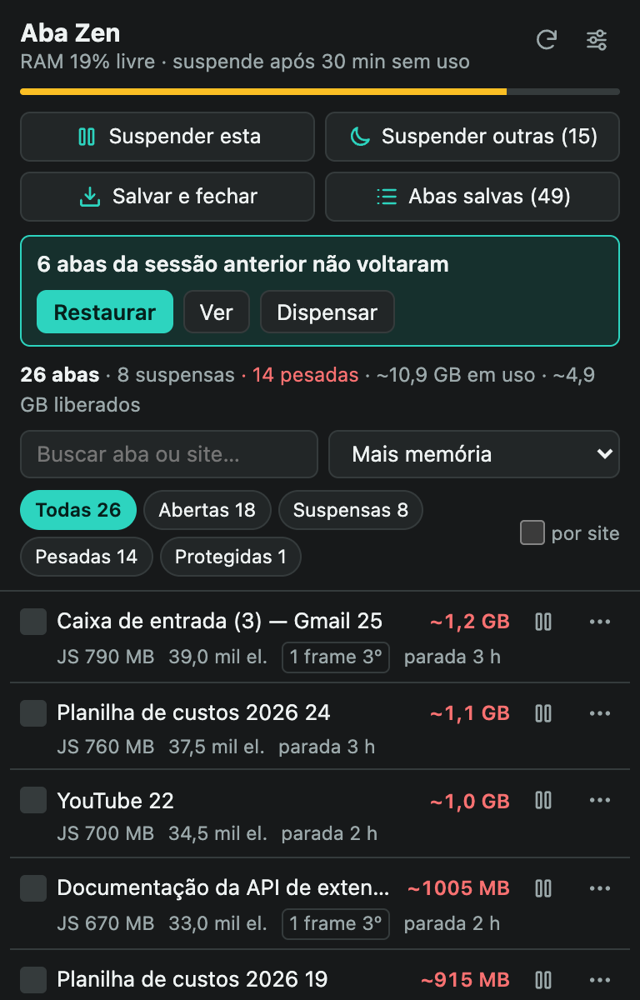
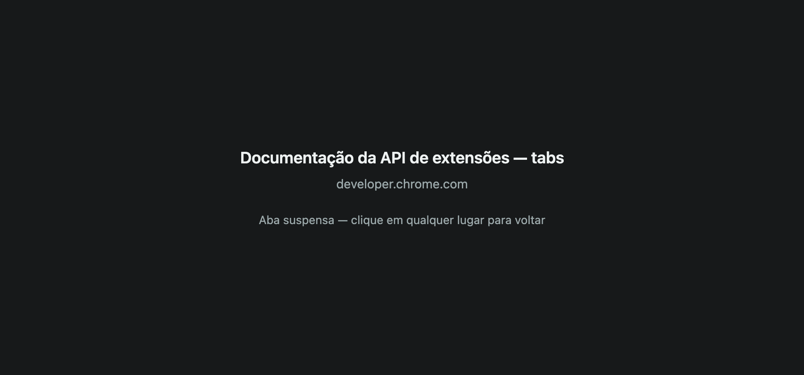
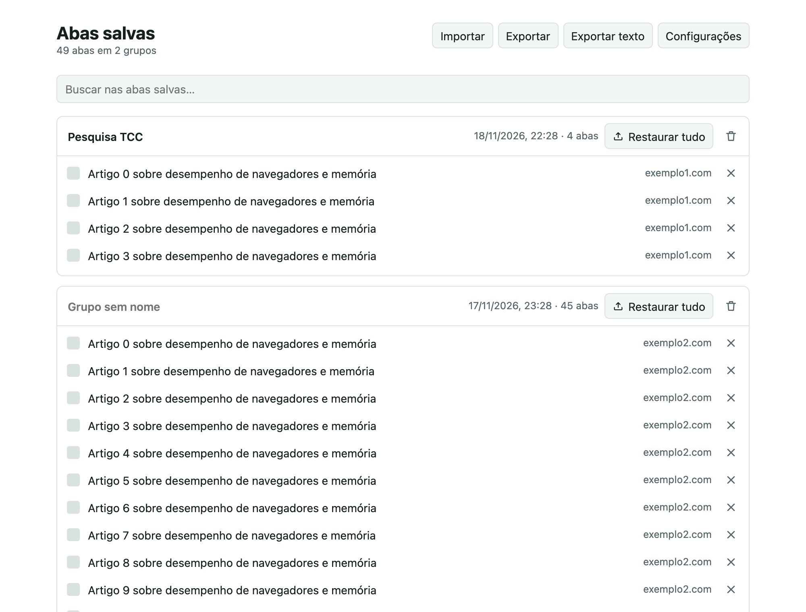
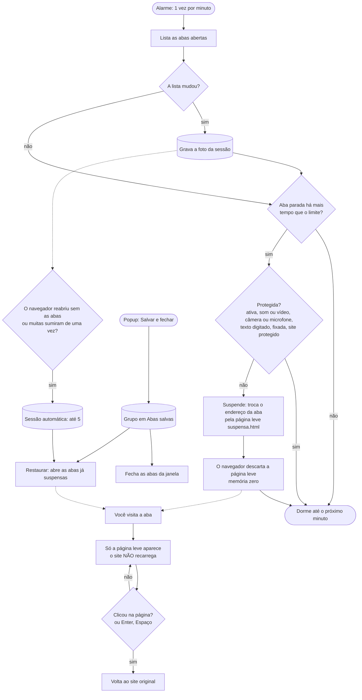

# Aba Zen

Extensão de navegador que **suspende as abas paradas**, **guarda abas em grupos** para abrir depois e **recupera as abas** quando o navegador fecha de repente. Feita para gastar o mínimo possível: ela mesma quase não usa memória nem CPU. Funciona no Chrome, Edge, Brave, Opera, Vivaldi, Arc, Dia (Chromium) e, em modo experimental, no Firefox. Windows, macOS e Linux.

  
  

  
  

## O que faz

- **Suspende abas paradas.** A aba sem uso há 30 minutos (ajustável) é trocada por uma página leve da própria extensão, com o mesmo título e ícone. **Visitar a aba não recarrega o site**: ele só volta quando você clica em qualquer lugar da página (ou aperta Enter/Espaço). Dá para passar pelas abas à vontade sem acordar nenhuma.
- **Aperta o passo quando falta memória.** Com a RAM livre abaixo do limite (15%), basta a aba estar parada há 5 minutos. *(Só no Chromium; o Firefox não informa a RAM.)*
- **Salva abas em grupos, como o OneTab.** Guarde as abas da janela (fechando ou não) e abra de novo quando quiser — uma, um grupo ou tudo. As abas restauradas já abrem suspensas: não custam nada até você clicar. Dá para renomear grupos, buscar, exportar e importar (inclusive a lista exportada pelo OneTab, no formato `url | título`).
- **Recupera abas perdidas.** A cada minuto, se algo mudou, a extensão anota quais abas estão abertas. Se o navegador travar, fechar de repente ou uma janela cheia for fechada sem querer, as últimas 5 sessões ficam em **Abas salvas** para restaurar.
- **Mostra o peso das abas, sob demanda.** Ao abrir o popup: memória estimada, CPU, elementos, frames de terceiros e tempo parada de cada aba, com busca, filtros, ordenação e agrupamento por site. Suspenda ou reative uma aba, um site inteiro ou tudo o que está filtrado.

## Por que é leve

- **O ciclo de 1 minuto não mede aba nenhuma.** Ele só consulta a lista de abas, vê quais estão paradas e, se mudou algo, grava a foto da sessão. Sem mensagens para todas as abas, sem contador no ícone.
- **Medição só com o popup aberto.** O peso das abas é calculado quando você pede, não o tempo todo.
- **Aba suspensa = memória zero.** Depois de carregar, a página de aba suspensa é descartada pelo navegador; ao visitá-la, só essa página leve é recarregada, nunca o site.
- **Abas restauradas abrem suspensas.** Restaurar 50 abas salvas não carrega 50 sites.
- **Sem rede, sem dependências, sem build.** JavaScript puro, uns poucos arquivos. Os scripts nas páginas só anotam "há texto digitado" e "há câmera/microfone em uso" e respondem quando a extensão pergunta.

## Nunca suspende automaticamente

- a aba que você está usando e abas tocando áudio;
- abas usando câmera, microfone ou compartilhando a tela;
- abas com texto digitado e ainda não enviado;
- abas fixadas (opcional) e as que o navegador marcou para não descartar;
- os sites protegidos — Google Meet, Microsoft Teams, Zoom e WhatsApp Web já vêm na lista;
- a aba que você marcou como "não suspender esta aba" (vale até fechá-la ou reiniciar o navegador);
- nada, enquanto o computador estiver sem internet (a aba não conseguiria voltar).

Suspender uma aba **manualmente** é um pedido seu e vale mesmo para as protegidas.

## Atalhos

| Atalho | O que faz |
|---|---|
| `Alt+Shift+S` | Suspende ou reativa a aba atual |
| `Alt+Shift+A` | Salva e fecha as abas da janela |

Para trocar: `chrome://extensions/shortcuts` (Chromium) ou `about:addons` → ⚙ → **Gerenciar atalhos de extensões** (Firefox).

## Instalar

**Chromium (Chrome, Edge, Brave, Opera, Vivaldi, Arc, Dia):** `chrome://extensions` (ou `edge://extensions`) → ligar **Modo do desenvolvedor** → **Carregar sem compactação** → escolher esta pasta.

**Firefox 128+:** rode `python3 ferramentas/empacotar.py` e, em `about:debugging#/runtime/this-firefox` → **Carregar extensão temporária**, escolha `dist/aba-zen-<versão>-firefox.zip`. (O `manifest.json` da raiz é o do Chromium; o script gera o do Firefox. O pacote para as lojas Chromium é `dist/aba-zen-<versão>-chrome.zip`.)

## Suporte por navegador

| | Chromium | Firefox |
|---|---|---|
| Suspender abas paradas (por tempo) | ✅ | ✅ |
| Suspender mais cedo com a RAM apertada | ✅ | ❌ sem API de RAM do sistema |
| Salvar, restaurar, exportar e importar abas | ✅ | ✅ |
| Recuperação de sessão | ✅ | ✅ |
| Ícone do site na aba suspensa | ✅ sem rede (cache do navegador) | ⚠️ só quando o ícone vem embutido (nunca busca na rede) |
| Peso das abas no popup | ✅ | ✅ (sem memória do JS) |
| CPU por aba | ✅ | ❌ sem `longtask` |
| Status | testado | **experimental**, sem teste manual ainda |

Safari ainda não é suportado (precisa de conversão via Xcode). Contribuições são bem-vindas.

## Como funciona

| Arquivo | Papel |
|---|---|
| `config.js` | Configuração padrão e funções puras compartilhadas (inclusive montar e ler o endereço de uma aba suspensa) |
| `sessoes.js` | Funções puras dos grupos salvos, das fotos da sessão e de exportar/importar |
| `background.js` | O ciclo de 1 minuto: suspende as paradas, grava a foto da sessão, atende o popup e as outras páginas |
| `suspensa.html` | A página leve que fica no lugar da aba suspensa |
| `salvas.html` | Abas salvas e sessões automáticas |
| `popup.html`, `options.html` | Painel das abas e configurações |
| `medidor.js` | Roda em cada página: mede quando pedem e avisa se há texto digitado não enviado |
| `midia.js` | Roda no mundo da página só para saber se há câmera/microfone/tela em uso |

**Suspender** é trocar o endereço da aba por `suspensa.html#t=<título>&f=<ícone>&u=<endereço>`. Tudo o que é preciso para voltar está no próprio endereço, então a aba suspensa sobrevive a reinício, travamento e à restauração de sessão do navegador, sem depender de nada guardado. Ao clicar, a página faz `location.replace` para o endereço original — e só aceita `http`/`https`.

**Foto da sessão:** endereço, título e posição das abas abertas, regravada apenas quando a lista muda. Quando o navegador abre de novo, a foto anterior vai para as sessões automáticas (se alguma aba tiver ficado para trás); quando muitas abas somem de uma vez, também.

**Estimativa de peso** (só no popup): `30 MB + heap JS + 1,5 MB por mil elementos + 25 MB por frame de terceiro`. É uma **estimativa**: navegadores não expõem a memória real por aba para extensões. Para o número exato, use o gerenciador de tarefas do navegador (Shift+Esc no Windows/Linux, menu Janela no macOS, `about:processes` no Firefox).

## Limites (é bom saber)

- **Se a extensão for removida ou desativada, as abas suspensas fecham** — elas são páginas da extensão. Reative as abas antes de remover e mantenha uma exportação das **Abas salvas** (os dados da extensão também somem na remoção). Atualizações são aplicadas só no próximo reinício do navegador, e as abas suspensas que se perderem ao recarregar a extensão são recriadas.
- **Páginas com aviso "sair do site?"** podem pedir confirmação na hora de suspender; se você cancelar, a aba fica como está.
- **Ao voltar, a página é carregada de novo:** posição da rolagem e estado que não esteja no endereço se perdem. Por isso abas com texto digitado não são suspensas sozinhas.
- **O navegador ainda pode descartar abas por conta própria** (Economia de Memória do Chrome/Edge) antes do nosso prazo; essas recarregam ao serem visitadas. No ciclo seguinte a extensão as converte em abas suspensas. Se preferir, desligue a Economia de Memória do navegador.
- **A foto da sessão é de até 1 minuto atrás** e não inclui janelas anônimas nem páginas internas (`chrome://`, `about:`, arquivos locais).

## Privacidade

Nada sai da máquina: não há nenhuma requisição de rede. Configurações, histórico das últimas 30 suspensões automáticas, grupos de abas salvas e fotos da sessão (título, endereço e ícone) ficam em `storage.local`, no seu computador. A última medição fica em `storage.session` (some ao fechar o navegador). Janelas anônimas nunca são guardadas. Detalhes na [política de privacidade](PRIVACY.md).

## Contribuir

Issues e PRs são bem-vindos. Testes: `node --test`. Pacotes para as lojas: `python3 ferramentas/empacotar.py` (gera `dist/`). Ideias em aberto:

- Guardar e devolver a posição da rolagem ao reativar
- Grupos de abas do navegador (cor e nome) nas abas salvas e na recuperação
- Arrastar abas entre grupos salvos; grupos travados
- Estimativa melhor: somar imagens decodificadas, `<canvas>` e vídeos tocando
- Medição real via app auxiliar opcional (*native messaging*)
- Traduções (`_locales`), testes no Firefox e versão para Safari

## Licença

[MIT](LICENSE)

---

**English:** Aba Zen ("Zen Tab") is a browser extension (Chromium + experimental Firefox) that suspends idle tabs into a lightweight placeholder page — visiting a suspended tab does not reload it; only clicking the page does —, saves tabs into groups like OneTab, and recovers your tabs after a crash or an accidentally closed window. Built to be cheap: no per-minute measuring, suspended tabs use no memory, no network requests, no dependencies. Nothing leaves your machine. Contributions welcome, including translations.
